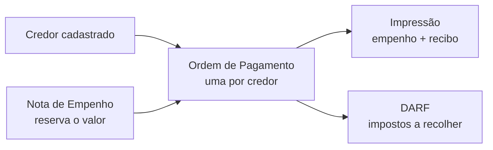
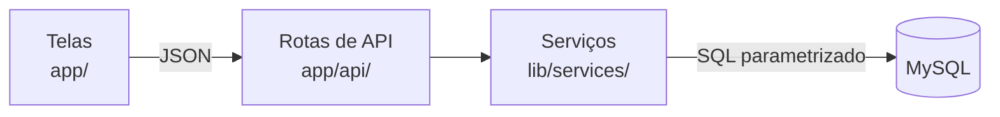

# Sistema de Empenho — Gestão Financeira
**Estado de Pernambuco · Secretaria da Fazenda**

Sistema web para controlar a execução da despesa pública: do empenho (a reserva do valor no orçamento) até o pagamento ao credor, com o cálculo automático dos impostos retidos, a impressão dos documentos oficiais e o acompanhamento das DARFs.

---

## Como funciona

O caminho do dinheiro no sistema tem quatro etapas:



1. **Nota de Empenho (NE):** registra o valor reservado para uma despesa, com o elemento e o subelemento de despesa.
2. **Ordem de Pagamento (OP):** a partir de uma NE, emite os pagamentos — um ou vários credores de uma vez, uma OP para cada. O sistema calcula as retenções, confere o saldo da NE e grava tudo de uma vez só.
3. **Impressão:** gera a Nota de Empenho e o recibo no modelo oficial, prontos para imprimir ou salvar em PDF.
4. **DARF:** cada OP com retenção que deve ser recolhida gera uma DARF pendente, que é marcada como paga quando o recolhimento é feito.

---

## Funcionalidades

| Módulo | O que faz |
|---|---|
| **Painel** | Total a pagar, credores ativos, NEs dos últimos 30 dias e as últimas movimentações. |
| **Credores** | Cadastro de pessoas físicas e empresas (CPF/CNPJ validados), com preenchimento automático pelo CNPJ (Receita) e pelo CEP, dados bancários, PIX, município e indicação de MEI. |
| **Notas de Empenho** | Cadastro e edição das NEs, aviso de NE parecida (mesmo valor, elemento e subelemento), saldo de cada NE (valor, gasto e restante) e cancelamento. |
| **Ordem de Pagamento** | Emissão de várias OPs da mesma NE, numeração automática por NE, itens da despesa, cheque, prévia das retenções e lista das OPs recentes. O administrador pode excluir uma OP lançada por engano, informando o motivo. |
| **Consulta / Impressão** | Documentos de uma NE ou de um lote de OPs: frente (empenho), verso (recibo) ou os dois, com valores por extenso. |
| **DARF** | Acompanhamento por competência (mês), por OP ou por credor, com baixa (marcar como paga) e reabertura em lote. |
| **Configurações** | Alíquotas e regras de retenção por elemento de despesa, parâmetros do transporte autônomo, ISS por município, faixas do IRRF e cadastro de elementos e subelementos. |
| **Usuários** | Criação de usuários, perfis de acesso, bloqueio e exclusão. |
| **Meu Perfil** | Dados do usuário e troca de senha. |

---

## Perfis de acesso

| Perfil | Pode |
|---|---|
| **Administrador** | Tudo, inclusive configurar as retenções, gerenciar usuários e excluir OPs. |
| **Gestor** | Cadastrar credores e NEs, emitir OPs, imprimir e dar baixa nas DARFs. |
| **Consulta** | Ver e buscar tudo, sem alterar nada. |

As permissões são conferidas no servidor a cada requisição: um usuário bloqueado perde o acesso na hora, e uma troca de perfil vale no próximo clique.

---

## Regras de negócio

- **Retenções calculadas pelo servidor.** IRRF, ISS, INSS, SEST/SENAT e outros descontos seguem a configuração do administrador para cada elemento de despesa. A tela mostra uma prévia, mas o valor gravado é sempre o calculado pelo servidor.
- **Transporte autônomo (elemento 3.3.90.33)** tem cálculo próprio: tabela progressiva do IRRF por vigência, ISS conforme o município do credor e taxa de expediente.
- **MEI** não sofre retenção. Só o administrador pode liberar uma retenção manual em credor MEI, e essa decisão fica registrada.
- **Patronal é informativa:** aparece na OP e na DARF, mas não é descontada do credor.
- **Saldo da NE:** a soma das OPs nunca passa do valor da NE. Duas pessoas emitindo na mesma NE ao mesmo tempo não conseguem gastar o mesmo saldo.
- **Histórico preservado:** credor excluído fica inativo, NE cancelada continua visível, OP com DARF paga não pode ser excluída, e usuário que já registrou algo é bloqueado em vez de excluído.
- **Auditoria:** criações, alterações, cancelamentos e exclusões ficam registrados com o usuário, a data e os dados de antes e depois.
- **Configuração versionada:** uma OP já emitida guarda as alíquotas usadas no dia; mudar a configuração vale só para as OPs novas.

---

## Tecnologias

| Camada | Tecnologia |
|---|---|
| Interface | Next.js 16 (App Router), React 19, TypeScript, Tailwind CSS 4 |
| Formulários e validação | React Hook Form, Zod |
| Servidor | Rotas de API do Next.js (Node.js) |
| Banco de dados | MySQL 8, acessado pela biblioteca mysql2 |
| Autenticação | Token JWT em cookie (jose), senhas com bcrypt |
| Testes | Vitest e Testing Library (unidade e integração), Playwright (ponta a ponta) |
| Integração contínua | GitHub Actions: tipos, lint, testes, build e E2E a cada PR |
| Entrega | Build `standalone` do Next.js, com Dockerfile |

---

## Arquitetura



- **As telas nunca acessam o banco.** Elas chamam as rotas de API, que conferem o login e o perfil e chamam os serviços, onde ficam as regras de negócio.
- **Consultas parametrizadas** em todo o acesso ao banco, contra SQL injection.
- **Transações** nas operações que mexem em várias tabelas (emissão de OPs, DARF, auditoria): ou tudo é gravado, ou nada.
- **Dinheiro em centavos inteiros** no código e `DECIMAL` no banco, para não haver erro de arredondamento.
- **Banco compartilhado com outros sistemas:** a estrutura só muda por scripts SQL versionados (`database/migration_*.sql`), sempre acrescentando, nunca removendo, e rodados manualmente pelo responsável pelo banco.

### Estrutura de pastas

```
app/              telas (uma pasta por módulo) e rotas de API (app/api)
components/       componentes de interface por módulo
lib/              regras puras (retenções, dinheiro, impressão) e serviços de banco (lib/services)
hooks/            hooks de dados das telas
database/         scripts SQL: schema, migrations e consultas de conferência (só leitura)
tests/            testes de unidade e de integração
e2e/              testes de ponta a ponta (Playwright)
docs/             documentação do projeto
```

---

## Documentação

- [`docs/revisao-abas.md`](docs/revisao-abas.md) — revisão funcional de cada tela: problemas encontrados, correções e roteiro de teste.
- [`docs/projeto-retencoes-v2/`](docs/projeto-retencoes-v2/) — projeto das retenções: requisitos, decisões e arquitetura.
