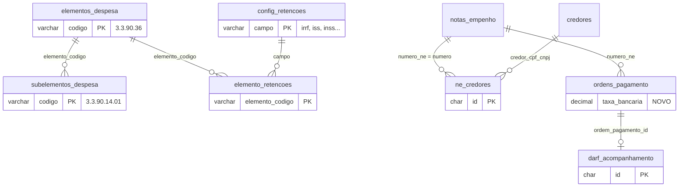

# Arquitetura — Projeto Retenções v2

> Documento de desenho. Nada aqui foi implementado. Referência de código: commit `006d34c`.

## 1. Estado atual (resumo do que foi lido no código)

| Tema | Como é hoje | Onde |
|---|---|---|
| Alíquotas | Fixas em **dois lugares**: formulário (`0.015`, `0.05`, `0.11`, `0.025`, `0.20`) e servidor (bloco `perfil !== 'ADMIN'`) | `components/op-form/OpTaxesSection.tsx`, `lib/services/ordem-pagamento.service.ts` (`criar` e `atualizar`) |
| Quais impostos aplicar | Todos os 5 marcados para qualquer elemento; só o ADMIN edita; o servidor usa "valor > 0" como indício de que o imposto estava marcado (um cliente pode enviar 0 e pular um imposto) | idem |
| Arredondamento | `Math.round(x*100)/100` e `maskCurrency(vp*0.015)` (ponto flutuante). Ex.: 11,00 × 1,5% = 0,165 vira **0,16** | `OpTaxesSection.tsx`, `lib/utils.ts` |
| Elemento/Subelemento | Duas listas soltas em `lib/constants.ts` (`ELEMENTOS`, `SUBELEMENTOS`), sem vínculo entre si; gravados como texto | `app/notas-empenho/page.tsx`; na OP vêm da NE (`OpPaymentData.tsx`) |
| NE × credor | A NE guarda **um** credor (`credor_nome`, `cpf_cnpj`); a OP guarda o credor próprio (FK `fk_op_credor`) | `notas_empenho`, `ordens_pagamento` |
| Número da OP | Gerado só ao salvar: `numero_empenho` guarda o **número da OP** (`2026.OP.0001`), `numero_ne` guarda a NE, `sub` o sub-empenho (`01`, `02`…), com `FOR UPDATE` e até 5 tentativas | `OrdemPagamentoService.criar` |
| Exclusão de OP | `DELETE` físico, com registro em `auditoria_financeira` | `OrdemPagamentoService.excluir` |
| Impressão | Rótulos fixos: "IRRF (1,5%)", "ISS (5%)", "INSS (11%)", "PATRONAL (20%)", "SEST/SENAT (2,5%)" | `components/consulta-impressao/ReciboVia.tsx` |
| Perfis | `ADMIN`, `GESTOR`, `CONSULTA` (o `lib/store.ts` ainda tipa `'USER'`: inconsistência) | `usuario.service.ts`, `lib/store.ts` |
| Município | O credor já tem `cidade` + `uf` (rótulo "Município"), preenchidos por consulta de CNPJ/CEP | `credores`, `app/credores/page.tsx` |

## 2. Princípios de desenho

1. **O servidor é a autoridade.** O formulário só exibe e sugere; o servidor recalcula retenções a partir da configuração do banco e do elemento da NE (não confia em valores enviados, exceto campos que o admin liberou).
2. **Uma única implementação de cálculo**, em código puro (`lib/money.ts` + `lib/retencoes.ts`), usada pelo servidor, pelo formulário, pela tela do admin (simulador) e pelos testes.
3. **Configuração em tabelas, não em constantes.** Alíquotas, flags e matriz elemento×imposto vivem no banco e o admin as edita.
4. **Compatível com o banco compartilhado:** somente tabelas novas e colunas novas com `DEFAULT`; colunas legadas continuam sendo gravadas.
5. **Dinheiro em centavos inteiros** dentro do motor de cálculo; conversão para `DECIMAL(15,2)` só na borda.
6. **Auditável:** mudanças de configuração e de status da DARF entram em `auditoria_financeira`; cada OP guarda o snapshot das alíquotas usadas.

## 3. Modelo de dados proposto



### Tabelas novas

| Tabela | Finalidade | Task |
|---|---|---|
| `elementos_despesa` | Cadastro de elementos (código, descrição, ativo, legado, ordem, **perfil de cálculo**) | T02 |
| `subelementos_despesa` | Subelementos ligados ao elemento (`3.3.90.14.01`…) | T02 |
| `config_retencoes` | Uma linha por campo de *Retenções e Descontos*: tipo, alíquota, automático, editável pelo operador, entra na DARF, ativo | T03 |
| `elemento_retencoes` | Matriz elemento × imposto: quais impostos se aplicam | T03 |
| `ne_credores` | (T14) Credores de uma NE com o bruto de cada um. **Sem uso desde a rodada 2**; mantida no banco | T14 |
| `darf_acompanhamento` | Uma linha por OP que tem DARF, com competência e status | T19 |
| `calculo_parametros` | Percentuais e constantes do perfil `TRANSPORTE_AUTONOMO` (20%, 11%, 60%, 607,20, 978,62…), **por vigência** | T24 |
| `irrf_faixas` | Faixas da tabela do IRRF (limite, alíquota, parcela a deduzir), **por vigência** | T24 |
| `iss_municipios` | ISS por município: alíquota e **taxa de expediente da prefeitura** | T24 |

### Colunas novas em `ordens_pagamento` (T09)

`taxa_bancaria DECIMAL(10,2) NOT NULL DEFAULT 0`, `taxa_pix DECIMAL(10,2) NOT NULL DEFAULT 0` e `retencoes_snapshot JSON NULL` (alíquotas e regras usadas no cálculo).

### Coluna em `credores` (rodada 2, T32/T33)

`municipioExpediente VARCHAR(100) NULL` — **camelCase**, exceção à convenção `snake_case`: a coluna já existia em produção (criada fora de migration, vazia em 13/10/2026). A `migration_17` só a cria nos ambientes onde ela falta. **Nunca** criar `municipio_expediente` (D41).

## 4. Motor de cálculo

### 4.1 Arredondamento (R1)

Regra: **olhar o 3º decimal; 5 ou mais sobe**. Para valores não negativos isso é equivalente ao "meio para cima" clássico (9,9749 → 9,97; 9,975 → 9,98).

Implementação (T01), sem depender de ponto flutuante:

```
calcPercentCents(baseCents, aliquotaPercent):
  aliq = round(aliquotaPercent * 10_000)            // 1,5 -> 15000 (4 casas decimais de %)
  return floor( (baseCents * aliq + 500_000) / 1_000_000 )   // BigInt para evitar overflow
```

`arredondarMoeda(x: number)` (para valores já em ponto flutuante): `x.toFixed(10)` elimina o ruído binário (9,975 → "9.9750000000") e a regra do 3º decimal é aplicada sobre a *string*.

### 4.2 Retenções (T10)

Entradas: bruto da OP (centavos), código do elemento, configuração (`config_retencoes`), matriz (`elemento_retencoes`), valores informados pelo operador e o perfil.

```
para cada campo tributário (irrf, iss, inss, patronal, sest_senat):
  se !config[campo].ativo                       -> 0
  se !matriz[elemento][campo]                   -> 0   (ex.: .14 não tem imposto)
  se config[campo].calculo_automatico           -> calcPercentCents(bruto, aliquota)
  senão                                         -> valor informado (digitado)
  se (config[campo].editavel_operador || perfil == ADMIN) e valor informado presente
                                                -> usa o informado (validado: 0 <= v <= bruto)
para campos de desconto (outros, taxa_bancaria, taxa_pix):
  não dependem do elemento; usam o valor informado (se o campo estiver ativo e permitido)
se credor é MEI                                 -> todos os campos tributários = 0  ("Isento (MEI)")
total_descontos = soma dos centavos dos campos com desconta_credor = 1   (a PATRONAL é informativa: fica de fora)
liquido        = bruto - total_descontos          (erro 422 se total > bruto)
```

Saída: valores em centavos, total, líquido, avisos e `snapshot` (alíquotas/flags usadas).

### 4.3 Perfis (estratégias) de cálculo — T10, T25

Cada elemento aponta para um **perfil de cálculo** (`elementos_despesa.perfil_calculo`):

| Perfil | Elementos | Como calcula |
|---|---|---|
| `SIMPLES` | .30, .36, .39, .47 e legados | percentuais de `config_retencoes` sobre o **bruto** (seção 4.2) |
| `TRANSPORTE_AUTONOMO` | **.33** | cálculo da planilha EJA Campo (abaixo) |

**Estrutura no código, parâmetros no banco.** A ordem dos passos é código testado; os números (percentuais, tabela do IRRF, redutor, ISS por município) ficam em `calculo_parametros`, `irrf_faixas` e `iss_municipios`, editáveis **só pelo ADMIN**, com **vigência por data**. Não há fórmula livre editável (um erro de fórmula viraria dinheiro errado).

```
base_inss      = bruto x 20%                         (sem arredondar)
inss           = base_inss x 11%      patronal = base_inss x 20%  (informativa)
sest           = base_inss x 1,5%     senat    = base_inss x 1%
desc_simpl     = max(607,20 ; inss)                  (sem arredondar)
base_irrf      = bruto x 60% - desc_simpl
irrf           = tabela(base_irrf)  = base x aliq - parcela   (isento na 1a faixa)
desc_adicional = max(0 ; 978,62 - 0,133145 x bruto)  (usa o bruto, como a planilha)
irrf_final     = max(0 ; irrf - desc_adicional)
iss            = bruto x aliq_municipio + taxa_expediente_municipio
total          = irrf_final + iss + inss + sest + senat        (sem a patronal)
liquido        = bruto - total
```

- Passos intermediários em **aritmética exata** (T01, escala de 6 casas); só os **itens finais** são arredondados (3º decimal) e depois somados.
- Vigência: para cada parâmetro vale a linha de maior `vigente_de` ≤ data de referência da OP (`data_pagamento` > `data_emissao` > hoje).
- **MEI:** `credores.is_mei` zera todas as retenções tributárias, em qualquer perfil.
- A **taxa de expediente da prefeitura** é parte do ISS do município; **não** é a taxa bancária.
- Validação: o fixture da planilha (91 motoristas) reproduz o cálculo; 63 exatos e 5 com 1 centavo de diferença por causa do arredondamento em dois passos da planilha (T28).

### 4.4 Fonte do elemento

O servidor lê o `elemento` **da NE** (já é consultada com `FOR UPDATE` dentro da transação) e extrai o código com `extrairCodigoElemento("3.3.90.36 - Outros Serviços…") → "3.3.90.36"`. O valor enviado pelo cliente é ignorado para decidir regras.

### 4.5 NE sem credor e emissão de OPs em lote (rodada 2)

**Modelo.** A **NE** é só o empenho: número, valor, unidade, gestão, elemento, **subelemento**, data de provisão e **observações** (`historico`). Ela **não tem credor** e **não tem** Data de Emissão nem Data de Pagamento (as colunas continuam no banco, nulas nas NEs novas; os outros sistemas não as leem — D47). O `exercicio` de uma NE nova vem dos 4 primeiros dígitos do número (`2026NE…`, 2000–2099), senão do ano da Data de Provisão, senão do ano corrente, e nunca é recalculado na edição (D42). Os credores são escolhidos **na Ordem de Pagamento**: uma emissão pode ter vários, e cada credor gera **uma OP própria**.

```
NE (R$ 100,00)  --- saldo = valor - SUM(valor_pagamento das OPs) --->  R$ 10,00 restantes
   |
   +-- emissão em lote (POST /api/ordens-pagamento/lote), na MESMA transação:
         OP 2026.OP.0012 /01  credor A  R$ 30,00  cheque 101  pagamento 20/10
         OP 2026.OP.0013 /02  credor B  R$ 25,00  cheque 102  pagamento 20/10
         OP 2026.OP.0014 /03  credor C  R$ 35,00  cheque 103  pagamento 05/11
```

**Fluxo do lote (servidor)**
1. valida o payload (credor repetido, valores > 0, máximo de 100, cheques únicos);
2. abre a transação e trava a NE (`FOR UPDATE`); confere que não está cancelada;
3. `saldo = valor da NE − SUM(valor_pagamento)` em centavos; recusa (**422**) se a soma do lote passar; confere cheques (banco + lote) e credores **ativos** (a FK `fk_op_credor` não olha `ativo`);
4. para cada credor, em ordem: `criarOpNaTransacao` — numera (`calcularProximoNumeroOp` na mesma conexão), calcula as retenções (motor T10/T25: MEI, perfil do elemento, `dataPagamento` **do credor**, `credores.municipioExpediente`), grava a OP e sincroniza a DARF. **O core não mexe no status da NE**;
5. recalcula o status da NE **uma vez** (`recalcularStatusNe`: `EMITIDO`, `PARCIALMENTE PAGO`, `LIQUIDADO`; `CANCELADO` nunca é sobrescrito);
6. qualquer erro desfaz **tudo**; colisão de número refaz o lote (até 5 vezes); `ER_DUP_ENTRY` de `uq_cheque` vira `credores[i]` (índice achado pelo valor em `sqlMessage`).

**Regras**
- **Gasto = valor a pagar (bruto)** das OPs. **Valor a pagar** de cada credor = soma dos itens da especificação dele.
- **Município (Expediente)** (`credores.municipioExpediente` — camelCase, coluna que já existia em produção; **nunca** criar `municipio_expediente`, D41) define a taxa de expediente da prefeitura, **só no 3.3.90.33**; sem ele a taxa é 0 e **não há aviso** (D45). Preenchido e sem cadastro em `iss_municipios` → alíquota padrão, taxa 0 e aviso.
- Dados do credor gravados na OP (nome, RG, endereço) vêm do **cadastro**, não do cliente. A OP não tem colunas de conta bancária.
- `historico` de cada OP do lote: itens unidos por " | "; sem itens, as Observações da NE; sem elas, "Pagamento referente ao empenho &lt;NE&gt;".
- **Prévia (D43):** servidor **só no 3.3.90.33** (`POST /api/ordens-pagamento/previa-lote`, aceita qualquer subconjunto de linhas); nos demais elementos, cálculo no navegador por linha.
- **Status da NE:** sempre derivado do saldo por `recalcularStatusNe` (OP: criar/atualizar/excluir; NE: atualizar); a edição da NE não aceita `status` do cliente.
- **Reduzir o valor da NE** abaixo do já gasto continua **409** (D46).
- **Release (D44):** T30, T31, T34 (lote) e T35 (lista) saem juntas; T32/T33 podem sair antes.
- `ne_credores` (T14) permanece no banco, **sem uso**; nunca é lida nem validada pelo fluxo novo.
- A edição de uma OP existente continua **individual** (`PUT /api/ordens-pagamento/[id]`).

## 5. Contratos de API (novos e alterados)

| Método e rota | Perfis | Descrição | Task |
|---|---|---|---|
| `GET /api/elementos` | todos | Elementos ativos com subelementos e matriz de retenções | T04 |
| `POST/PUT/DELETE /api/elementos[/codigo]` e `/api/subelementos` | ADMIN | CRUD (DELETE = `ativo=0`) | T04 |
| `GET /api/configuracoes/retencoes` | todos | Campos + matriz. `Cache-Control: no-store` | T06 |
| `PUT /api/configuracoes/retencoes` | **ADMIN** | Salva campos e matriz numa transação, com auditoria | T06 |
| `GET /api/ordens-pagamento/proximo-numero?numeroNe=…` | ADMIN, GESTOR | `{ numeroOp, sub, rotulo, previsto: true }` | T13 |
| `POST/PUT /api/ordens-pagamento` | ADMIN, GESTOR | Passa a aceitar `taxaBancaria`, `taxaPix`; devolve `numeroOp` e `sub` definitivos | T10, T13 |
| `POST/PUT /api/notas-empenho` | ADMIN, GESTOR | **Rodada 2:** não aceita mais credor — `credores`, `credorNome` e `cpfCnpj` são **ignorados** se vierem; `status` também deixa de ser aceito no `PUT` (é derivado do saldo). Redução do valor abaixo do gasto → 409 | T15 → T30, T31 |
| `GET /api/notas-empenho[?busca]` e por número | todos | **Rodada 2:** **não devolve** `credores`; devolve `criadaEm` e `saldo` (`valor`, `gasto`, `restante`, `percentualGasto`, `qtdOps`); mantém `credorNome`/`cpfCnpj` legados | T15 → T29, T30, T31 |
| `GET /api/notas-empenho/duplicidade` | todos | **Rodada 2:** `valor` + `elemento` + `subelemento` (credor opcional, legado) | T30 |
| `POST /api/ordens-pagamento/previa` | ADMIN, GESTOR | Prévia de **uma** OP pelo **mesmo motor** da gravação. A tela a usa **só no 3.3.90.33**; nos demais elementos calcula no navegador (D43). (O plano chamava esta rota de `previa-retencoes`, nome que nunca existiu.) | T10, T25 |
| `GET/PUT /api/configuracoes/calculo-transporte` | leitura todos · **escrita ADMIN** | Percentuais do perfil do 3.3.90.33, por vigência | T27 |
| `GET/PUT /api/configuracoes/irrf` | leitura todos · **escrita ADMIN** | Faixas da tabela do IRRF, por vigência | T27 |
| `GET/POST/PUT /api/configuracoes/iss-municipios` | leitura todos · **escrita ADMIN** | ISS e taxa de expediente por município | T27 |
| `POST /api/ordens-pagamento/lote` | ADMIN, GESTOR | Emite **uma OP por credor** para a mesma NE, na mesma transação (tudo ou nada) | T34 |
| `POST /api/ordens-pagamento/previa-lote` | ADMIN, GESTOR | Prévia das retenções e do líquido por credor, **sem gravar**; aceita qualquer subconjunto de linhas e responde por índice. Usada só quando a NE é do 3.3.90.33 (D43) | T34 |
| `GET /api/ordens-pagamento/proximo-numero?numeroNe=&quantidade=` | ADMIN, GESTOR | Próximos N números de OP (previsão); sem `quantidade`, igual ao anterior | T34 |
| `GET /api/notas-empenho/saldo?numero=` | todos | Valor, gasto, restante, % gasto e quantidade de OPs da NE | T31 |
| `GET /api/darf` | todos | Lista/agrupa por competência, status e credor, com totais | T20 |
| `POST /api/darf/status` | ADMIN, GESTOR | Marca `PAGA`/`PENDENTE` em lote, com data e observação | T20 |

Padrão de erro: o mesmo já usado (`withErrorHandler`, `{ error }` e códigos 400/401/403/404/409/422).

## 6. Fluxos principais

### 6.1 Criar OP (rodada 2: emissão em lote)

```mermaid
sequenceDiagram
  participant U as Operador
  participant F as Formulário OP
  participant A as API /ordens-pagamento/lote
  participant S as OrdemPagamentoService
  participant DB as MySQL
  U->>F: escolhe a NE e adiciona os credores (lista)
  F->>A: GET proximo-numero?quantidade=N (previsão) e GET notas-empenho/saldo
  F->>F: NE do .33 -> POST previa-lote (linhas alteradas); demais -> cálculo local por linha
  U->>F: valor, cheque, data, itens e taxas por credor
  F->>A: POST lote
  A->>S: criarLote()
  S->>DB: BEGIN; trava a NE; confere saldo, cheques e credores ativos
  loop cada credor
    S->>S: criarOpNaTransacao(): numera, calcula (autoridade)
    S->>DB: INSERT ordens_pagamento (+ snapshot); UPSERT darf_acompanhamento
  end
  S->>DB: recalcularStatusNe; auditoria CREATE_LOTE; COMMIT
  S-->>F: OPs criadas (numeroOp e sub definitivos) e saldo
```
A OP individual (`POST /api/ordens-pagamento`) e a edição (`PUT /api/ordens-pagamento/[id]`, D37) seguem o mesmo caminho para **uma** OP, sem `ne_credores`.

### 6.2 Alterar alíquota (admin)

`PUT /api/configuracoes/retencoes` → transação grava `config_retencoes`/`elemento_retencoes` + auditoria → próxima leitura (`GET`, que não usa cache) já traz os valores novos → qualquer OP **criada ou recalculada depois** usa a regra nova. OPs já gravadas **não mudam** (D12) e guardam o snapshot do que foi usado.

### 6.3 NE sem credor e saldo (rodada 2 — substitui "NE com vários credores")

O usuário cadastra a NE **sem credor** e sem consumir o valor todo → os credores são escolhidos **na OP** (emissão em lote, seção 4.5) → o único limite é o **saldo da NE** (`valor − SUM(valor_pagamento)`, em centavos), mostrado como total, gasto e restante. **Não há mais limite por credor.** `ne_credores` (rodada 1) fica no banco **sem uso**: não é lida nem escrita (D36). *(Fluxo antigo da rodada 1, descartado: soma dos brutos por credor = valor da NE e limite do bruto restante de cada credor.)*

## 7. Permissões

| Ação | ADMIN | GESTOR | CONSULTA |
|---|:-:|:-:|:-:|
| Ver retenções, elementos, DARF | ✔ | ✔ | ✔ |
| Editar configuração de retenções/elementos | ✔ | – | – |
| Editar tabela do IRRF, parâmetros do transporte e ISS por município | ✔ | – | – |
| Criar/editar NE e OP | ✔ | ✔ | – |
| Editar valores de retenção direto na OP | ✔ | só campos liberados (`editavel_operador`) | – |
| Marcar DARF como paga | ✔ | ✔ | – |

## 8. Concorrência e consistência

- Número da OP: continua com `FOR UPDATE` + `UNIQUE` + retry (já existe). A previsão da T13 **não reserva** número.
- A **NE** é travada na transação (`SELECT … FOR UPDATE`) antes de somar as OPs, para que duas emissões simultâneas não estourem o saldo. **`ne_credores` não é mais travada nem lida** (D36).
- Cheque: checagem antes do `INSERT` + `UNIQUE KEY uq_cheque`; no lote, o `ER_DUP_ENTRY` de cheque vindo de outra transação é mapeado para a linha (`credores[i]`).
- Status da NE: um único `recalcularStatusNe`, sempre dentro da mesma transação que mexeu nas OPs.
- A DARF é sincronizada **na mesma transação** da OP (criar/editar/excluir), evitando divergência.

## 9. Estratégia de banco e deploy

1. Migrations `11` a `17` (numeração real do repositório; a rodada 2 é a `17`) rodam no Workbench, sempre antes do deploy do código. **Não há homologação separada** (D49): a conferência é o roteiro e as consultas só de leitura de [`HOMOLOGACAO-RODADA-2.md`](./HOMOLOGACAO-RODADA-2.md) e `database/consultas/conferencia_rodada2.sql`. A `migration_17` já foi conferida em produção (14/10/2026).
5. Entrega: build `standalone` (`node server.js`, como no `Dockerfile` e no CI), guardando a versão anterior no servidor para o rollback. Roteiro na seção 5 do documento de homologação.
2. Cada script é idempotente e termina com `INSERT IGNORE INTO schema_migrations`.
3. Seeds são conferidos pelo usuário antes de ir para produção (matriz de retenções e alíquotas).
4. Rollback: blocos comentados; qualquer `DROP` só com aprovação explícita.

## 10. Alternativas descartadas

| Alternativa | Por que não |
|---|---|
| Guardar a matriz de impostos em JSON numa linha de configuração | Difícil de auditar, validar e consultar; tabela `elemento_retencoes` é simples e indexável |
| Manter o cálculo no navegador e só validar no servidor | Foi a origem do desvio atual; o servidor precisa ser a autoridade |
| Alterar `notas_empenho` para guardar vários credores em JSON | Quebraria os outros sistemas e dificultaria o limite por credor; tabela `ne_credores` é mais segura |
| Criar o status da DARF como colunas em `ordens_pagamento` | Mistura responsabilidade e exige `ALTER` em tabela compartilhada; tabela própria é mais limpa |
| Renomear `numero_empenho` (que guarda o nº da OP) | Banco compartilhado; só documentar |
| **Rodada 2:** manter os credores na NE e só relaxar a soma | O supervisor quer escolher os credores na emissão da OP; a NE de R$ 100,00 com emissão de R$ 90,00 deixaria "credores" sem sentido na NE |
| **Rodada 2:** um **único documento** de OP para todos os credores da emissão | Retenção, cheque, data de pagamento e DARF são **individuais** por credor; a planilha EJA Campo já funcionava com um sub-empenho por motorista |
| **Rodada 2:** criar as OPs do lote em transações separadas | Uma falha no meio deixaria parte das OPs criadas; o lote é tudo ou nada |
| **Rodada 2:** apagar `ne_credores` | Regra do banco compartilhado: nunca `DROP`; a tabela fica sem uso |
