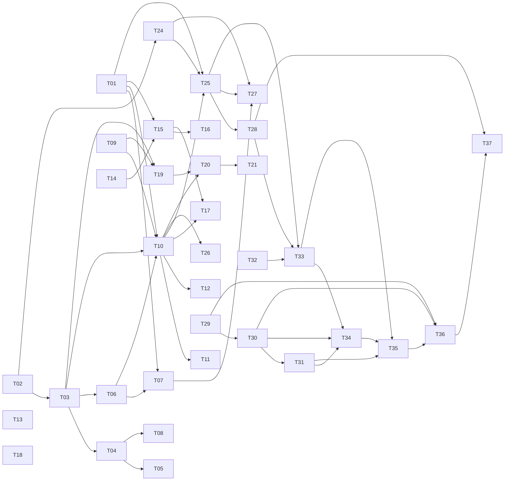

# Projeto Retenções v2 — Plano de Implementação

> **Status (19/10/2026):** rodada 1 implementada (T01–T28, faltando o fechamento T22/T23); **rodada 2 implementada** (T28–T36, PRs #39 a #52) e em homologação pelo roteiro da T37 — ver [`HOMOLOGACAO-RODADA-2.md`](./HOMOLOGACAO-RODADA-2.md) e a seção 16.
> **Base analisada:** `main` no commit `006d34c` (06/10/2026) para a rodada 1; **`main` no commit `caf215e` (13/10/2026)** para a rodada 2 (T29 a T37).
> **Escopo:** retenções por elemento, tela de administração das taxas, taxas bancária/PIX, NE com vários credores, número previsto da OP, município do credor, status da DARF, novos elementos/subelementos e o **cálculo do transporte (3.3.90.33) conforme a planilha EJA Campo**, com IRRF por tabela, ISS por município e isenção de MEI.
> **Atualizado em 07/10/2026** com as decisões da segunda rodada (ver seções 4 e 5).
> **Atualizado em 13/10/2026** com os ajustes pedidos pelo supervisor após o teste (rodada 2: NE sem credor, credores na OP em lote, saldo da NE, Município (Expediente)). Tasks **T29 a T37**.
> **Revisado em 13/10/2026** contra o código e o banco: decisões **D41 a D47** (seção 5), estimativas novas (seção 9) e pré-requisitos da rodada 2 (seção 11a).

Este documento é o ponto de entrada. Os detalhes técnicos estão em [`ARQUITETURA.md`](./ARQUITETURA.md) e cada entrega está descrita em um arquivo de [`tasks/`](./tasks).

---

## 1. Objetivo

Hoje o formulário da Ordem de Pagamento (OP) marca **todos** os impostos para **qualquer** elemento de despesa, com alíquotas fixas no código (IRRF 1,5%, ISS 5%, INSS 11%, SEST/SENAT 2,5%, Patronal 20%), e o cálculo usa ponto flutuante, o que erra centavos em alguns casos. A NE aceita um único credor, não há controle da DARF e a tela não mostra qual será o número da OP.

O projeto muda isso para:

- as **regras de retenção dependerem do elemento** escolhido;
- as **taxas serem definidas pelo administrador** em uma tela e valerem para todos os usuários;
- o **arredondamento** seguir a regra oficial (3º decimal ≥ 5 arredonda para cima);
- a NE aceitar **vários credores**, com valor bruto por credor fechando com o valor da NE;
- existir uma **tela de status da DARF**.

## 2. Origem dos requisitos

Anotações manuscritas do usuário (4 fotos: tabela de elementos com marcações, "Ideias para o sistema", página da dízima e o elemento 3.3.90.47) e três rodadas de esclarecimento por conversa. As anotações originais **não** foram incluídas no repositório; o que importa foi transcrito aqui.

## 3. Requisitos (rastreabilidade)

| ID | Requisito | Tasks |
|----|-----------|-------|
| R1 | Arredondamento: se o 3º decimal for 5 ou mais, o valor sobe (ex.: 9,975 → 9,98) | T01, T10 |
| R2 | Campos **Taxa bancária (expediente)** e **Taxa PIX** em *Retenções e Descontos*, digitados na hora | T09, T10, T11, T12 |
| R3 | Retenções dependem do elemento (.14 é sem imposto; .30/.36/.39/.47 usam os percentuais padrão do sistema) | T02, T03, T04, T05, T10, T11 |
| R4 | Tela do **ADMIN** para editar **todos** os campos de retenções e descontos; vale para todos os usuários | T03, T06, T07 |
| R5 | Em caso específico, o admin pode **habilitar alteração manual** | T03, T06, T07, T10, T11 |
| R6 | Tela de status separada com **todos os credores que tiverem DARF** | T19, T20, T21 |
| R7 | Vários credores em uma NE; usuário informa o **bruto** de cada um; soma dos brutos = valor da NE | T14, T15, T16, T17 |
| R8 | Salvar o **município** no credor | T18 |
| R9 | Na OP, mostrar qual número será (NE …/01 ou /02 e nº da OP) | T13 |
| R10 | Novos elementos e subelementos, em cascata | T02, T04, T05, T08 |
| R11 | **Cálculo do transporte autônomo (3.3.90.33)** igual ao da planilha EJA Campo (base de 20%, INSS 11%, SEST/SENAT, IRRF por tabela) | T24, T25, T28 |
| R12 | **Tabela do IRRF e demais parâmetros editáveis só pelo ADMIN**, com data de vigência | T24, T27 |
| R13 | **ISS por município**, com a **taxa de expediente da prefeitura** | T18, T24, T25, T27 |
| R14 | **Credor MEI não sofre nenhuma retenção** (IRRF, ISS, INSS, SEST/SENAT e patronal) | T10, T26 |
| R15 | **Patronal é informativa**: aparece na OP e na impressão, mas não desconta do credor | T03, T09, T10, T12 |
| R16 | **NE:** título "Cadastro de Nota de Empenho"; sem Data de Emissão e Data de Pagamento; "Especificação" vira "Observações"; **Subelemento sempre visível** (texto livre quando não há lista) | T29 |
| R17 | **NE sem credor:** os credores deixam a NE e são escolhidos na Ordem de Pagamento | T30, T34, T35 |
| R18 | **NE parcial:** pode ser salva e usada sem consumir o valor todo; mostra **total, gasto e restante** | T30, T31 |
| R19 | **Município (Expediente)** no cadastro de credores, opcional; é ele que define a taxa de expediente (só no 3.3.90.33) | T32, T33 |
| R20 | **OP em lote:** vários credores na emissão, **uma OP por credor**, com nº da OP, valor a pagar, **nº do cheque e data do pagamento por credor** | T34, T35 |
| R21 | **Especificação de pagamento por credor** (itens), minimizada na tela | T34, T35 |
| R22 | Ajustes de consulta, impressão e DARF para as mudanças acima | T36 |

> **Substituições (rodada 2):** **R7** ("vários credores em uma NE; soma dos brutos = valor da NE") foi **substituído** por R17, R18 e R20. A tabela `ne_credores` fica no banco, sem uso.

### Fora do escopo (ADIADO por decisão do usuário)

- lembrete de DAE não gerado e controle das guias de ISS por prefeitura;
- salvar empenhos automaticamente;
- importar planilha de cálculo base para gerar empenhos (a planilha EJA Campo é o modelo; a T14 e o fixture da T28 já deixam a base pronta).

## 4. Decisões fechadas

1. `3.3.90.14` (subelementos `.01` e `.03`) é **sem nenhum imposto**.
2. **Só o 3.3.90.33** usa o cálculo da planilha EJA Campo (perfil `TRANSPORTE_AUTONOMO`). Os elementos `.36`, `.39`, `.30` e `.47` usam os **percentuais padrão** da tela do admin (D14, D20).
3. **MEI zera tudo**, em qualquer elemento (D16).
4. **A patronal não desconta do credor**, aparece na impressão e fica fora do líquido (D15).
5. Arredondamento: o combinado (3º decimal, 5 ou mais sobe), **sem** os dois passos da planilha (D17).
6. A **taxa de expediente da prefeitura** (dentro do ISS do .33) é diferente da **taxa bancária** (D18).
7. O **IRRF e seus parâmetros** (tabela, desconto simplificado, redutor) são editáveis **só pelo ADMIN**, com vigência por data (D19).
8. O **IRRF não entra na DARF** (na planilha o IR vai para a Secretaria da Fazenda) (D4).
9. Taxa bancária e taxa PIX são **valores digitados na hora**, sem valor fixo.
10. ~~A soma dos brutos tem que fechar exatamente com o valor da NE.~~ **Substituída em 13/10:** a soma das OPs deve ser **menor ou igual** ao valor da NE; o que sobra fica como saldo.
11. Ainda **não há credores cadastrados**: backfills (T14, T19) são dispensáveis.
12. **Subelemento** sempre visível na NE; sem lista cadastrada, é **texto livre** opcional (D26).
13. **Município (Expediente)** é opcional e vale **só no 3.3.90.33** por enquanto; é ele que determina sozinho a taxa de expediente (D27, D38).
14. **"Valor a pagar" é o bruto**; a **especificação de pagamento** é a tabela de itens por credor, e a soma dos itens é igual ao valor a pagar (D28).
15. **Cada credor tem OP própria**, com seu nº da OP, cheque e data de pagamento (D29).
16. A NE pode ser salva **sem credor** e **sem consumir o valor todo**; a tela mostra total, gasto e restante (D30).
17. O rótulo é **"Observações"** (plural) (D31).
18. A coluna do Município (Expediente) é **`credores.municipioExpediente`** (camelCase, já existente); **nunca** criar `municipio_expediente` (D41).
19. `exercicio` de NE nova = ano do **número da NE** (`2026NE…`); senão ano da Data de Provisão; senão ano corrente; nunca recalculado na edição (D42).
20. Prévia das retenções: **servidor só no 3.3.90.33**, navegador nos demais — também na emissão em lote (D43).
21. **T30, T31, T34 (lote) e T35 (lista) saem no mesmo release**; T32 e T33 podem sair antes (D44).
22. Credor do .33 **sem** Município (Expediente): taxa 0 e **sem aviso**; o alerta de "60 dias" da Data de Pagamento da NE sai (D45).
23. Reduzir o valor da NE abaixo do gasto continua **HTTP 409** (D46).
24. A `migration_17` **não faz `MODIFY`**; os outros sistemas **não leem** as colunas de data/credor da NE (D47).
25. A **edição de OP não está na tela** desde 09/2026 (commit `581c3ba`) e **não foi recriada** na T35-B; toda OP nova sai pela emissão em lote, inclusive com um credor só. A rota `PUT /api/ordens-pagamento/[id]` continua, com testes. Se a edição voltar a ser pedida, vira task própria (D48, 19/10/2026).
26. **Sem ambiente de homologação separado:** a homologação é o roteiro de [`HOMOLOGACAO-RODADA-2.md`](./HOMOLOGACAO-RODADA-2.md) com dados de teste identificáveis e limpeza pela aplicação, até existir um banco de teste (D49, 19/10/2026).

Detalhes de D41 a D47 na seção 5.

## 5. Decisões em aberto (as tasks já assumem a coluna "Suposição")

| ID | Pergunta | Suposição adotada | Afeta |
|----|----------|-------------------|-------|
| D2 | O que é "habilitar alteração em caso específico"? | Flag **por campo** `editavel_operador` na tela do admin. O ADMIN continua podendo editar direto na OP. | T06, T07, T10, T11 |
| D3 | Elementos antigos (3.3.90.32, .35, .40, 4.4.90.51, .52): continuam? | Continuam ativos, "legado", com os percentuais padrão. | T02, T03 |
| D5 | Estados do status da DARF | `PENDENTE` e `PAGA` (coluna VARCHAR, extensível). | T19–T21 |
| D6 | Mês de competência da DARF | `data_pagamento` da OP, com fallback para `data_emissao`. | T19, T20 |
| ~~D7~~ | ~~NE com vários credores: o que vai nas colunas legadas?~~ | **OBSOLETA (rodada 2, D36):** a NE não tem mais credor; `ne_credores` fica sem uso e as colunas legadas ficam `NULL` nas NEs novas. | ~~T15~~ |
| D9 | Subelementos dos demais elementos | Sem lista oficial: campo opcional quando não houver subelementos cadastrados. | T05, T08 |
| D10 | Município do credor é obrigatório? | Não, mas sem município no 3.3.90.33 o ISS usa o padrão e **avisa**. | T18 |
| D11 | Taxas bancária e PIX saem do líquido do credor? | Sim, entram em "Total de Descontos". | T10, T12 |
| D12 | Ao **editar** uma OP antiga com a config nova | Recalcula só se valor, elemento ou credor mudarem. | T10 |
| D13 | OP com DARF já paga pode ser editada/excluída? | Não (HTTP 409). | T20 |
| D21 | **Patronal entra na DARF?** | Sim (anotação do usuário); detalhada à parte do "retido". Confirmar com quem monta a guia; o admin desliga sem mexer em código. | T03, T20, T21 |
| D22 | O **desc. adicional do IRRF usa o bruto** (e não os 60% tributáveis) e a tabela/redutor de 2026 estão corretos? | Replica a planilha exatamente. **Confirmar com a contabilidade.** | T24, T25 |
| D23 | A **taxa de expediente da prefeitura** vale também para o ISS de .36 e .39? | Não: só no 3.3.90.33 (como na planilha). Parâmetro por perfil. | T24, T25 |
| D24 | Credor **MEI** ainda paga taxa bancária/PIX digitada? | Sim, só as retenções zeram. | T10, T26 |
| D25 | Data que define a **vigência** das tabelas | `data_pagamento` > `data_emissao` > hoje. | T24, T25 |

Fechadas na rodada 1 (07/10): D1 (ISS), D4, D8 (.47 usa os padrões), D14 a D20.
Fechadas na rodada 2 (13/10): D26 a D31 e D38 (ver seção 4); D41 a D47 (tabela abaixo das em aberto). Obsoleta: D7.

**Em aberto da rodada 2 (as tasks T29 a T37 já assumem a suposição):**

| ID | Pergunta | Suposição adotada | Afeta |
|----|----------|-------------------|-------|
| D32 | A coluna "Data" da lista de NEs (hoje a data de pagamento) vira o quê? | **Data de cadastro** (`created_at`), com o rótulo "Cadastro". | T29 |
| D33 | Como avisar NE duplicada sem credor? | **Valor + elemento + subelemento**; continua só **aviso**. | T30 |
| D34 | "Data Emissão OP" continua na OP? | Sim, **no topo**, uma só por emissão (o supervisor não a citou). | T35 |
| D35 | A emissão em lote é "tudo ou nada"? E credor repetido? | **Tudo ou nada** (rollback total); **credor repetido** na mesma emissão é recusado. | T34, T35 |
| D36 | O que acontece com `ne_credores`? | Fica no banco, **sem uso**: não é lida nem validada. NEs antigas não restringem mais. | T30, T34 |
| D37 | Editar uma OP existente | Continua **individual** (um credor, travado). | T35 |
| D39 | A via impressa da NE muda o nome "ESPECIFICAÇÃO OU HISTÓRICO"? | **Não** (layout oficial). | T36 |
| D40 | Atalho "Aplicar data a todos" | Incluído como opcional; o supervisor confirma. | T35 |

**Fechadas em 13/10/2026, após a revisão das tasks contra o código e o banco:**

| ID | Decisão | Afeta |
|----|---------|-------|
| D41 | A coluna do Município (Expediente) **já existe** no banco como **`credores.municipioExpediente`** (camelCase, `VARCHAR(100) NULL`), criada fora de migration, vazia e sem uso no código. **Manter esse nome** (exceção à convenção `snake_case`); **nunca** criar `municipio_expediente`. A `migration_17` só a cria onde faltar. | T23, T25, T32, T33, T34 |
| D42 | `exercicio` de NE nova = **4 primeiros caracteres do número da NE**, se forem um ano entre 2000 e 2099 (ex.: `2026NE000123` → 2026); senão, ano da Data de Provisão; senão, ano corrente. **Nunca** recalculado no `atualizar`. (O usuário confirmou que os números de NE começam pelo ano.) | T29 |
| D43 | Prévia das retenções como já está implementado: **servidor só no 3.3.90.33** (`/previa`), **navegador nos demais**. Na emissão em lote todas as linhas têm o elemento da NE: NE do .33 → `POST /api/ordens-pagamento/previa-lote` (aceita qualquer subconjunto de linhas; o cliente manda só as que mudaram); outros elementos → cálculo local por linha. | T10, T11, T34, T35 |
| D44 | **T30, T31, T34 (lote) e T35 (lista) saem no mesmo release.** T32 e T33 podem sair antes (a T33 só depois da `migration_17` no ambiente). | T30, T31, T34, T35, T37 |
| D45 | Credor do .33 **sem** Município (Expediente): taxa 0 e **sem aviso** (o campo é "se for o caso"); só avisa se estiver preenchido e não existir em `iss_municipios`. O alerta de "data passada de 60 dias" da NE (ligado à Data de Pagamento) **sai** junto com o campo. | T29, T33 |
| D46 | Reduzir o valor da NE abaixo do já gasto continua **HTTP 409** (contrato e teste atuais). | T31 |
| D47 | A `migration_17` **não faz `MODIFY`**: só **reporta** as colunas da NE (já são `NULL`, confirmado no Workbench) e cria `credores.municipioExpediente` se não existir. O usuário confirmou que os **outros sistemas não leem** `data_pagamento`, `data_emissao`, `credor_nome` e `cpf_cnpj` da NE. Nunca `DROP`. Todo script começa com `USE empenho;`. | T29, T30, T32 |

## 6. Matriz de retenções (seed inicial, editável pelo admin)

| Elemento | Perfil de cálculo | IRRF | ISS | INSS | Patronal* | SEST/SENAT | Observação |
|---|---|:-:|:-:|:-:|:-:|:-:|---|
| 3.3.90.14 (e .14.01, .14.03) | – | – | – | – | – | – | **Sem imposto** |
| 3.3.90.30 | SIMPLES | ✔ | – | ✔ | ✔ | ✔ | |
| **3.3.90.33** | **TRANSPORTE_AUTONOMO** | ✔ | ✔ | ✔ | ✔ | ✔ | planilha EJA Campo; ISS por município + taxa de expediente |
| 3.3.90.36 | SIMPLES | ✔ | ✔ | ✔ | ✔ | ✔ | |
| 3.3.90.39 | SIMPLES | ✔ | ✔ | ✔ | ✔ | ✔ | |
| 3.3.90.47 | SIMPLES | ✔ | – | ✔ | ✔ | ✔ | |
| Legados (32, 35, 40, 4.4.90.51/.52) | SIMPLES | ✔ | ✔ | ✔ | ✔ | ✔ | revisar (D3) |

\* A **patronal** é **informativa** (não desconta do credor). Credor **MEI** não sofre nenhuma retenção em nenhum elemento.
Taxa bancária, Taxa PIX e "Outros" **não** dependem do elemento.

**Percentuais padrão (perfil SIMPLES, sobre o bruto):** IRRF 1,5% · ISS 5% · INSS 11% · Patronal 20% · SEST/SENAT 2,5%.
**Perfil do 3.3.90.33:** base 20% do bruto; INSS 11%, Patronal 20%, SEST 1,5%, SENAT 1% sobre a base; IRRF por tabela (60% do bruto − desc. simplificado) menos o desc. adicional; ISS 5% + taxa de expediente do município.

## 7. Exemplos numéricos de referência (viram casos de teste)

**Perfil SIMPLES** (patronal informativa, fora do líquido):

| Caso | Bruto | Elemento | Resultado esperado |
|---|---:|---|---|
| A | 1.000,00 | .36 | IRRF 15,00 · ISS 50,00 · INSS 110,00 · SEST/SENAT 25,00 → desc. **200,00** → **líquido 800,00** (patronal 200,00 informativa) |
| B | 665,00 | .36 | IRRF **9,98** · ISS 33,25 · INSS 73,15 · SEST/SENAT **16,63** → desc. 133,01 → **líquido 531,99** (patronal 133,00 informativa) |
| C | 1.000,00 | .30 | IRRF 15,00 · INSS 110,00 · SEST/SENAT 25,00 (sem ISS) → desc. 150,00 → **líquido 850,00** |
| D | 1.000,00 | .14.01 | nenhuma retenção → **líquido 1.000,00** |
| E | 665,00 | .36 + taxa bancária 8,50 | desc. 141,51 → **líquido 523,49** |
| F | 11,00 | .36 | IRRF 0,165 → **0,17** (hoje o sistema grava 0,16: bug de ponto flutuante) |

**Perfil TRANSPORTE_AUTONOMO (3.3.90.33), da planilha EJA Campo:**

| Caso | Bruto / município | Resultado esperado |
|---|---|---|
| G | 11.970,00 · Águas Belas | IRRF 899,34 · ISS 598,50 · INSS 263,34 · SEST 35,91 · SENAT 23,94 · patronal 478,80 (informativa) → desc. 1.821,03 → **líquido 10.148,97** |
| H | 6.317,50 · Canhotinho | IRRF 0,00 · ISS **331,08** (315,875 + taxa de expediente 15,20) · INSS 138,99 · SEST 18,95 · SENAT 12,64 → **líquido 5.815,84** |
| I | 6.288,30 · Bom Conselho · **não MEI** | base INSS 1.257,66 · IRRF 80,71, mas desc. adicional 141,36 → **IRRF 0,00** · ISS 314,42 · INSS 138,34 · SEST 18,86 · SENAT 12,58 → **líquido 5.804,10** |
| J | 6.288,30 · **MEI** | todas as retenções 0 → **líquido 6.288,30** |

**Rodada 2 — NE parcial e emissão em lote:**

| Caso | Situação | Resultado esperado |
|---|---|---|
| K | NE de R$ 100,00 · emissão com 3 credores: 30,00 + 25,00 + 35,00 | **3 OPs** em sequência (ex.: `…0012/01`, `…0013/02`, `…0014/03`); gasto **90,00**; restante **10,00**; NE "PARCIALMENTE PAGO" |
| L | Mesma NE, nova emissão de R$ 12,00 | **422** "Soma das OPs maior que o saldo da NE" e **nenhuma** OP criada |
| M | Emissão com 3 credores onde o 3º repete o nº do cheque do 1º | **409** com o índice da linha e **nenhuma** OP criada |
| N | Dois credores com datas de pagamento em meses diferentes | duas OPs, **duas competências** de DARF |
| O | .33 · credor com Município (Expediente) = Canhotinho · bruto 6.317,50 | ISS **331,08** (315,875 + 15,20); o mesmo credor **sem** o campo → ISS **315,88** |

O conjunto completo (91 motoristas) está em [`fixtures/eja-campo-5a-parcela.json`](./fixtures/eja-campo-5a-parcela.json) e é usado na T28.

## 8. Regras críticas do repositório (herdadas de `contexto_sessao_atual.md`)

1. O schema `empenho` é **compartilhado com outras aplicações em produção**. **Nunca** `DROP COLUMN` / `DROP TABLE`. Só `CREATE TABLE IF NOT EXISTS` e `ADD COLUMN`/`MODIFY` não destrutivos.
2. Scripts SQL são **executados manualmente no MySQL Workbench** por conta privilegiada (o usuário `admin` do app não tem `ALTER` nem `REFERENCES`). Todo script começa com `USE empenho; SET SQL_SAFE_UPDATES = 0;` e registra a versão em `schema_migrations`.
3. **Nada de `commit`/`push`** sem o usuário pedir.
4. Colunas legadas (`elemento_subelemento`, `credor_nome`, `cpf_cnpj`, `total_descontos`…) **continuam sendo gravadas** para não quebrar os outros sistemas. **Atenção:** `total_descontos` passa a **não incluir a patronal** nas OPs novas.
5. Antes de abrir PR: `npm run lint:types`, `npm run lint`, `npm test` e `npm run build` (é o que o CI roda).

## 9. Mapa de tasks

| ID | Título | Fase | Prior. | Estim.* | Depende de |
|----|--------|------|:-:|--:|------------|
| [T01](./tasks/TASK-01-arredondamento-monetario.md) | Função única de arredondamento monetário | 0 Fundação | P0 | 4 h | – |
| [T02](./tasks/TASK-02-migration-10-elementos.md) | Migration 10 — elementos, subelementos e perfil de cálculo | 1 Banco | P0 | 3 h | – |
| [T03](./tasks/TASK-03-migration-11-config-retencoes.md) | Migration 11 — config de retenções e regras por elemento | 1 Banco | P0 | 4 h | T02 |
| [T04](./tasks/TASK-04-api-elementos.md) | Serviço e API de elementos/subelementos | 2 Elementos | P1 | 6 h | T02, T03 |
| [T05](./tasks/TASK-05-cascata-elemento-subelemento.md) | Cascata elemento→subelemento nas telas | 2 Elementos | P1 | 6 h | T04 |
| [T06](./tasks/TASK-06-api-config-retencoes.md) | Serviço e API de configuração de retenções | 3 Config admin | P1 | 6 h | T03 |
| [T07](./tasks/TASK-07-tela-admin-retencoes.md) | Tela do admin — Retenções e Descontos | 3 Config admin | P1 | 10 h | T06, T01 |
| [T08](./tasks/TASK-08-tela-admin-elementos.md) | (Opcional) Tela do admin — elementos/subelementos | 3 Config admin | P3 | 8 h | T04 |
| [T09](./tasks/TASK-09-migration-12-colunas-op.md) | Migration 12 — taxa bancária, taxa PIX e snapshot na OP | 4 OP | P0 | 3 h | – |
| [T10](./tasks/TASK-10-motor-calculo-retencoes.md) | Motor de cálculo de retenções (estratégias, MEI, patronal informativa) | 4 OP | P0 | 12 h | T01, T03, T06, T09 |
| [T11](./tasks/TASK-11-formulario-op.md) | Formulário da OP: campos novos e prévia do servidor | 4 OP | P1 | 10 h | T10 |
| [T12](./tasks/TASK-12-impressao-op.md) | Impressão da OP dinâmica | 4 OP | P2 | 6 h | T10 |
| [T13](./tasks/TASK-13-numero-previsto-op.md) | Número previsto da OP e do sub-empenho | 5 Número | P1 | 5 h | – |
| [T14](./tasks/TASK-14-migration-13-ne-credores.md) | Migration 13 — tabela `ne_credores` | 6 Multi-credor | P0 | 3 h | – |
| [T15](./tasks/TASK-15-api-ne-multi-credor.md) | Serviço e API da NE com vários credores | 6 Multi-credor | P1 | 12 h | T14, T01 |
| [T16](./tasks/TASK-16-ui-ne-multi-credor.md) | Tela da NE: seleção de credores e valor bruto | 6 Multi-credor | P1 | 14 h | T15 |
| [T17](./tasks/TASK-17-op-com-ne-multi-credor.md) | OP integrada à NE com vários credores | 6 Multi-credor | P1 | 12 h | T15, T10 |
| [T18](./tasks/TASK-18-municipio-credor.md) | Município do credor (normalização e uso no ISS) | 7 Município | P1 | 3 h | – |
| [T19](./tasks/TASK-19-migration-14-darf.md) | Migration 14 — acompanhamento da DARF | 8 DARF | P0 | 4 h | T03, T09 |
| [T20](./tasks/TASK-20-api-darf.md) | Serviço e API da DARF | 8 DARF | P1 | 10 h | T19, T10 |
| [T21](./tasks/TASK-21-tela-status-darf.md) | Tela de status da DARF | 8 DARF | P1 | 12 h | T20 |
| [T22](./tasks/TASK-22-testes-regressao.md) | Testes de regressão e fechamento de qualidade | 9 Fechamento | P1 | 12 h | todas |
| [T23](./tasks/TASK-23-deploy-docs.md) | Deploy, checklist de produção e documentação | 9 Fechamento | P1 | 5 h | todas |
| [T24](./tasks/TASK-24-migration-15-parametros-transporte.md) | Migration 15 — parâmetros do transporte, tabela do IRRF e ISS por município | 10 Transporte | P0 | 4 h | T02 |
| [T25](./tasks/TASK-25-perfil-calculo-transporte.md) | Perfil de cálculo "Transporte autônomo" (3.3.90.33) | 10 Transporte | P0 | 14 h | T10, T24, T01 |
| [T26](./tasks/TASK-26-isencao-mei.md) | Isenção de credor MEI na OP e no cadastro | 10 Transporte | P1 | 4 h | T10 |
| [T27](./tasks/TASK-27-tela-admin-transporte.md) | Tela do admin — parâmetros do transporte, IRRF e ISS por município | 10 Transporte | P1 | 12 h | T24, T25, T07 |
| [T28](./tasks/TASK-28-teste-conformidade-planilha.md) | Teste de conformidade com a planilha EJA Campo | 10 Transporte | P1 | 8 h | T25, T10 |
| [T29](./tasks/TASK-29-ne-titulo-datas-observacoes-subelemento.md) | NE: título, sem datas, "Observações" e Subelemento sempre visível | 11 Rodada 2 | P1 | 7 h | – |
| [T30](./tasks/TASK-30-ne-sem-credor.md) | NE sem credor (retira "vários credores" da NE) | 11 Rodada 2 | P1 | 11 h | T29 |
| [T31](./tasks/TASK-31-ne-saldo-total-gasto-restante.md) | NE com saldo parcial: total, gasto e restante (+ PR 0: status da NE) | 11 Rodada 2 | P1 | 11 h | T30 |
| [T32](./tasks/TASK-32-migration-17-municipio-expediente.md) | Migration 17 — garantir `credores.municipioExpediente` e conferir colunas nulas da NE | 11 Rodada 2 | P0 | 1 h | – |
| [T33](./tasks/TASK-33-credor-municipio-expediente.md) | Credores: "Município (Expediente)" e uso na taxa de expediente | 11 Rodada 2 | P1 | 7 h | T32, T25, T28 |
| [T34](./tasks/TASK-34-api-emissao-op-lote.md) | API de emissão de OPs em lote (um credor = uma OP) | 11 Rodada 2 | P0 | 27 h | T30, T31, T33 |
| [T35](./tasks/TASK-35-ui-op-lista-credores.md) | Tela da OP: lista de credores | 11 Rodada 2 | P1 | 36 h | T34, T33, T31 |
| [T36](./tasks/TASK-36-impressao-consulta-ajustes.md) | Consulta, impressão e telas auxiliares | 11 Rodada 2 | P2 | 3 h | T29, T30, T35 |
| [T37](./tasks/TASK-37-testes-homologacao-deploy-rodada2.md) | Rodada 2: testes, homologação e deploy | 11 Rodada 2 | P1 | 10 h | T29–T36, T28 |

\* Estimativas **aproximadas** (confiança baixa), só para planejamento. Rodada 1 ≈ 205 h sem a T08; **rodada 2 (T29 a T37) ≈ 113 h** (revisada em 13/10/2026; era 87 h); **total ≈ 318 h sem a T08** (≈ 326 h com ela). A T36 tem +4 h se fizer o "Imprimir esta emissão" (opcional).
\*\* **Números das migrations nos títulos:** os títulos e nomes de arquivo das tasks antigas ("Migration 10" a "Migration 15") são **históricos**. Os arquivos reais são: T02 → `migration_11`, T03 → `12`, T09 → `13`, T14 → `14`, T19 → `15`, T24 → `16` e T32 → `17` (seção 15).
Prioridades: **P0** bloqueia outras tasks · **P1** requisito do usuário · **P2** complementar · **P3** opcional.

## 10. Dependências



`T13` (número previsto) e `T18` (município) **não dependem de nada** e podem entrar a qualquer momento.

## 11. Ordem recomendada de execução

1. **Ganhos rápidos e independentes:** T01 (arredondamento corrige um bug real hoje), T13, T18.
2. **Banco (Workbench):** T02 → T03 → T09 → T14 → T19 → T24. Rodar em homologação primeiro.
3. **Elementos:** T04 → T05.
4. **Config do admin:** T06 → T07.
5. **Núcleo da OP:** T10 → T11 → T12 → T26.
6. **Transporte (3.3.90.33):** T25 → T28 → T27.
7. **Vários credores:** T15 → T16 → T17.
8. **DARF:** T20 → T21.
9. **Fechamento da rodada 1:** T22 → T23.
10. **Rodada 2 (supervisor):** pré-requisitos (seção 11a) → T32 (banco, Workbench) → T29 → T30 → T31 → T33 → T34 PR A (extração do core) → T35 PR A (`basePath`, paridade) → T34 PR B (numeração múltipla) → T34 PR C (lote, `previa-lote`, cache) → T35 PR B (lista) → T36 → T37.
    **Release (D44):** T30, T31, T34 (lote) e T35 (lista) saem **juntas**. T32 e T33 podem sair antes (a T33 só depois da `migration_17` no ambiente). O build não quebra se a T30 entrar sozinha (a OP individual continua funcionando), mas o fluxo só faz sentido com a lista de credores da OP.

## 11a. Pré-requisitos da rodada 2

1. **T28 (teste de conformidade com a planilha EJA Campo):** feito em 14/10/2026 — `tests/unit/conformidade-eja-campo.test.ts` (63 exatas, 5 com 1 centavo, 23 isentas). A T33 muda a entrada desse teste (`municipioExpediente`) e a T37 o usa na regressão.
2. **PR 0 da T31 — status da NE na edição:** `NotasEmpenhoService.atualizar` grava `status || 'EMITIDO'` e a tela sempre envia `"EMITIDO"`; editar uma NE parcial, liquidada **ou cancelada** a devolve a `EMITIDO`. Corrigir (status derivado do saldo; `CANCELADO` só via `cancelar`) e rodar as consultas de conferência da T31. Pode sair antes de tudo, independente da rodada 2.
3. **`migration_17` em homologação** (T32) antes de qualquer código da T33. *Feito:* conferida em produção em 14/10/2026 (a coluna já existia).
4. Os pendentes da rodada 1, **T22** e **T23**, continuam valendo (a T37 repete o processo para a rodada 2).

## 12. Fluxo de trabalho

- **Branch por task:** `feat/t01-arredondamento`, `feat/t13-numero-previsto`…
- **Commits:** seguir o padrão do repositório (`feat:`, `fix:`, `chore:`, `docs:`, `test:`).
- **PR por task**, descrevendo o que mudou e anexando o resultado de `lint:types`, `lint`, `test` e `build`.
- **Definition of Done** (vale para toda task):
  - [ ] critérios de aceite da task atendidos;
  - [ ] testes novos/atualizados passando (`npm test`);
  - [ ] `npm run lint:types`, `npm run lint` e `npm run build` sem erro;
  - [ ] nenhuma coluna/tabela legada removida;
  - [ ] scripts SQL idempotentes, com `USE empenho;`, registro em `schema_migrations` e bloco de rollback comentado;
  - [ ] acessibilidade mantida (labels, `aria-*`, foco por teclado) em telas novas;
  - [ ] documentação da task atualizada se a decisão mudou.

## 13. Principais riscos

| Risco | Mitigação |
|---|---|
| Alterar retenções calculadas erradas em OPs já emitidas | Config só vale para OPs novas; edição preserva valores (D12); snapshot da alíquota em cada OP (T09/T10) |
| Quebrar os outros sistemas do banco compartilhado | Só `ADD COLUMN`/`CREATE TABLE`; colunas legadas continuam preenchidas; testar em homologação |
| Código novo publicado antes da migration | Rodar as migrations **antes** do deploy (T23) |
| Colunas `subelemento` curtas demais para o texto novo | T02 verifica `SHOW COLUMNS` e alarga (`MODIFY`, não destrutivo) |
| Mudança de arredondamento alterar centavos de relatórios antigos | Regra só vale para cálculos novos; decisão registrada em T01 |
| Dois usuários gerando OP ao mesmo tempo mudam o número previsto | O número é só previsão; o definitivo é reservado na transação (já existe retry) |
| O líquido das OPs novas **sobe** porque a patronal deixa de ser descontada | Avisar o supervisor antes do deploy; documentado na T23 |
| Tabela do IRRF, redutor ou ISS por município desatualizados | Parâmetros com **vigência**, editáveis só pelo ADMIN, e simulador na tela (T27) |
| Credor MEI não marcado como MEI paga retenção indevida | Selo MEI no cadastro/OP, cadastro cuidadoso (T26) |
| Diferença de 1 centavo em relação à planilha em ~7% dos motoristas com retenção | Conhecida e testada (T28); a regra de arredondamento fica em uma função só (T01) |
| **Rodada 2:** a emissão em lote mexe no coração do fluxo da OP (transação, número, saldo, DARF) | Extrair o core sem mudar comportamento (PR 1) e só depois o lote (PR 2); suíte antiga intacta; teste de concorrência (T34) |
| **Rodada 2:** NE nova sem credor e sem datas no banco compartilhado | O usuário confirmou (13/10/2026) que os outros sistemas **não leem** essas colunas da NE (D47); nada é removido, nunca `DROP`; as colunas só deixam de ser preenchidas nas NEs novas (T29, T30) |
| **Rodada 2:** a taxa de expediente passa a depender só do novo campo; credores cadastrados antes perdem a taxa até preenchê-lo | Avisar quem cadastra; aviso na tela do credor (T33). Na prévia só há aviso se o campo estiver preenchido com município sem cadastro (D45) |
| **Rodada 2:** código em produção antes da `migration_17` quebra o cadastro de credores e o cálculo do .33 nos ambientes que ainda não têm `credores.municipioExpediente` | Ordem obrigatória: backup → homologação → produção → **só depois** o deploy (T37). Em produção a coluna já existe (D41) |
| **Rodada 2:** status da NE volta a `EMITIDO` quando a NE é editada (bug atual), distorcendo saldo e dashboard | PR 0 da T31, com consultas de conferência dos dados já afetados |
| **Rodada 2:** criar `municipio_expediente` por engano (nome das versões antigas destes documentos) | D41; a `migration_17` verifica que `municipio_expediente` **não** existe |

## 14. Issues e Project no GitHub

> **Issues da rodada 2:** TASK-29 a TASK-37 são as issues **#30 a #38**. Em 14/10/2026 o título e o corpo delas foram **substituídos** pela versão revisada destes arquivos (checkboxes zerados). Se um arquivo de task mudar de novo, a fonte da verdade continua sendo **`docs/projeto-retencoes-v2/`**; atualizar a issue em seguida.

**Situação:** as issues TASK-01 a TASK-28 já existem. A rodada 2 (13/10/2026) cria as **TASK-29 a TASK-37** (milestone **M11 - Ajustes do supervisor (rodada 2)**) e **comenta** as issues cujo escopo mudou (T11, T13, T14, T15, T16, T17, T18, T22, T23, T25 e T28), **sem apagar** o corpo nem os checkboxes que você já marcou.

Com o `gh` autenticado:

```bash
# 1) simulação (não altera nada)
bash docs/projeto-retencoes-v2/scripts/atualizar-issues-github.sh

# 2) aplicar de verdade (pode rodar de novo: não duplica nem repete comentários)
DRY_RUN=0 bash docs/projeto-retencoes-v2/scripts/atualizar-issues-github.sh
```

Opções (variáveis de ambiente):
- `COMENTAR="TASK-13 TASK-14"` — escolhe quais issues existentes recebem o comentário "Atualização de escopo (rodada 2)".
- `SUBSTITUIR_CORPO=1` — em vez de comentar, **substitui o corpo** das issues listadas (apaga checkboxes marcados).

> O script antigo `criar-issues-github.sh` **não deve ser usado de novo** (duplicaria as issues); ele se bloqueia sozinho.
> No Windows (Git Bash) cada chamada ao `gh` demora; conte alguns minutos.

Para o quadro (GitHub Projects), as issues novas são adicionadas pelo botão **+ → Add items from repository**, ou:

```bash
gh auth refresh -s project
gh project item-add <NUMERO_DO_PROJETO> --owner euclideslaurindo --url <URL_DA_ISSUE>
```

Colunas sugeridas: **Backlog · Pronto para dev · Em andamento · Em revisão (PR) · Em homologação · Concluído**.

## 15. Numeração real das migrations

O plano original previa as migrations 10 a 15 (por isso os títulos e nomes de arquivo das tasks T02, T03, T09, T14, T19 e T24 citam "Migration 10" a "Migration 15" — são **históricos**). No repositório a sequência andou um número (o `migration_10.sql` é o `ultimo_acesso` de `usuarios`, fora do projeto), então vale esta tabela:

| Migration | Task | Conteúdo |
|---|---|---|
| `migration_11` | T02 | elementos e subelementos |
| `migration_12` | T03 | configuração de retenções |
| `migration_13` | T09 | taxa bancária, taxa PIX e snapshot na OP |
| `migration_14` | T14 | `ne_credores` (sem uso a partir da rodada 2) |
| `migration_15` | T19 | acompanhamento da DARF |
| `migration_16` | T24 | parâmetros do transporte, IRRF e ISS por município |
| **`migration_17`** | **T32** | garante `credores.municipioExpediente` (camelCase; já existe em produção — D41) e só **confere** as colunas nulas da NE, sem `MODIFY` (D47). Escrita e **executada em 14/10/2026** (a coluna já existia; só registrou a versão) |

## 16. Estado da rodada 2 (19/10/2026)

| Task | Entrega | PR |
|---|---|---|
| PR 0 (T31) | status da NE não volta a EMITIDO ao editar | #39 |
| T28 | conformidade com a planilha EJA Campo | #40 |
| T32 | `migration_17` (conferida em produção em 14/10) | #41 |
| T33 | Município (Expediente) no credor | #43 |
| T29–T31 | NE: título, sem datas, sem credor, saldo | #44 |
| T34 (A, B, C) | core da OP, numeração múltipla, emissão e prévia em lote | #45, #47, #48 |
| T35 (A, B) | `basePath` e tela de OP com lista de credores (3 rodadas) | #46, #49, #50, #51 |
| T36 | consulta e impressão ("Imprimir esta emissão") | #52 |
| T37 | rastreabilidade, roteiro de homologação, entrega e rollback | [`HOMOLOGACAO-RODADA-2.md`](./HOMOLOGACAO-RODADA-2.md), `database/consultas/conferencia_rodada2.sql` |

**Falta para fechar:** o checklist da homologação aprovado pelo supervisor e a entrega em produção (roteiro na seção 5 do documento de homologação). Depois disso, o fechamento da rodada 1: **T22** e **T23**.
